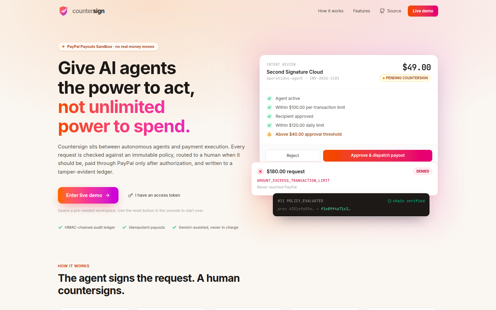
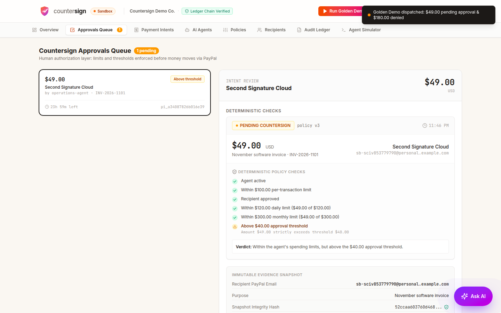
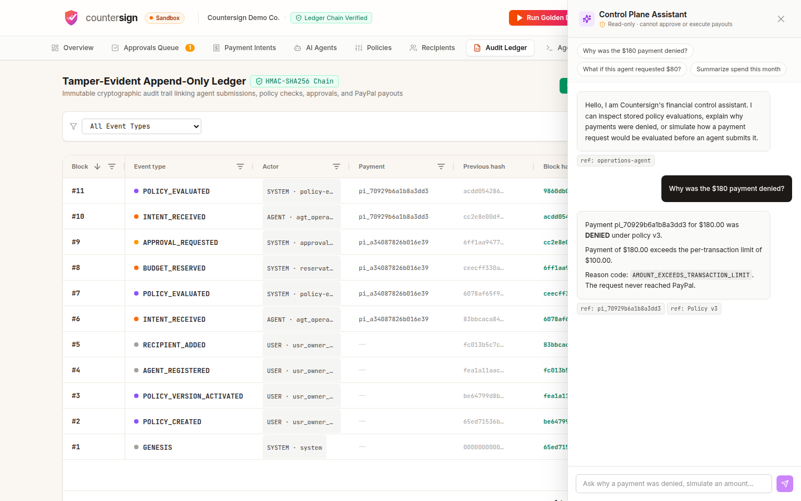
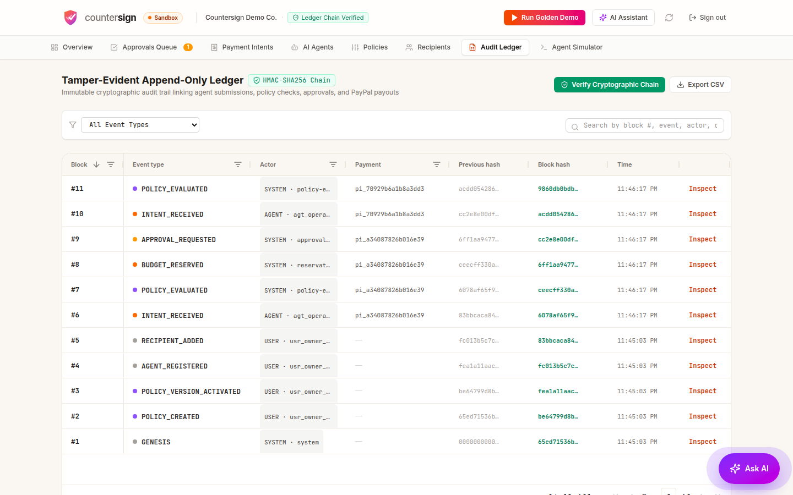

# Countersign

**Give AI agents the power to act, not unlimited power to spend.**

Countersign is an authorization and audit layer between autonomous AI agents and payment execution.
An agent asks to pay someone; Countersign checks the request against an immutable spending policy,
brings in a human when it should, pays through the **PayPal Payouts API** only after authorization, and
records every decision in a tamper-evident ledger.

**Live demo:** linked from this project's Devpost submission (PayPal Sandbox, no real money moves, no login needed)



## Why

AI agents are starting to buy things, pay invoices and renew subscriptions. Handing an agent a card or an
API key is risky: it can overspend, pay the wrong person, or be tricked into doing so. Dashboards that show
payments after the fact don't help. Countersign enforces the rules **before** money moves and keeps proof
of every decision. It is the buyer-side counterpart to merchant-side agentic-commerce tooling.

## SDK

A TypeScript SDK generated by APIMatic from `openapi.yaml` lives in [`sdk/`](sdk/EXAMPLE.md).

## How it works

```text
Agent submits intent → authenticate → deterministic policy + budget reservation
                                    ├── DENIED            (recorded, never reaches PayPal)
                                    ├── PENDING_APPROVAL  (a human countersigns)
                                    └── AUTHORIZED        (payout submitted)
                                                    ↓
                                     reconcile with PayPal (webhook + polling)
                                                    ↓
                                          settle or release budget
```

The agent can never approve its own payment. The decision is made by a pure, deterministic engine,
not by a prompt, and AI is used only to draft policies, explain decisions and simulate outcomes.



## Try it live (about two minutes)

1. Open the live demo from the Devpost page and click **Enter live demo**.
2. Click **Run Golden Demo**. A **$49** request queues for approval and a **$180** request is denied.
3. In **Approvals Queue**, review the decision card and approve the $49 request. A real PayPal Sandbox
   payout is submitted and settles within about a minute. Open the payment to see the PayPal batch and
   transaction IDs.
4. In **Audit Ledger**, sort and filter the events, then click **Verify Cryptographic Chain**.
5. Open the **AI assistant** (bottom right) and ask *"Why was the $180 payment denied?"* and
   *"What if this agent requested $80 right now?"*.
6. In **Agent Simulator**, click **Use demo agent token**, then try the 10x concurrency scenario.

The policy has a $120 daily cap, so repeated approvals will start being denied. That is the product
working. Use the reset button (top right) to return to a clean state. If the demo has been made private,
sign in with the access token from the project's Devpost testing instructions.



## Features

**Control**
- **Deterministic policy engine.** Per-transaction limit, daily and monthly caps, recipient allowlist and
  countersign thresholds, as pure TypeScript. Policies are immutable versions; invalid input fails closed.
- **Budget reservations.** Budget is held the moment a request is accepted, so concurrent requests cannot
  overspend a cap. Expired reservations are swept and released.
- **Human countersign.** Approvals are bound to a snapshot of the exact request and revalidated against the
  current agent, policy, recipient and budget before any money moves.
- **Agent identity.** Per-agent bearer tokens (`cs_<agentId>_<secret>`) verified against peppered HMAC
  hashes in constant time. A request cannot choose which agent it is.

**Money movement**
- **PayPal Payouts (Sandbox).** Server-to-server disbursements with three layers of idempotency
  (`Idempotency-Key`, `PayPal-Request-Id`, deterministic `sender_batch_id`).
- **Settlement you can trust.** Pending payouts stay reserved until PayPal confirms, through signature-verified
  webhooks and a reconciliation poll, so settlement never depends on a single delivery.

**Audit**
- **Tamper-evident ledger.** Append-only events chained with HMAC-SHA256 over the full record, verifiable in
  one click, with CSV export.
- **AG Grid tables.** The Audit Ledger and Payment Intents views use AG Grid: sorting, column filters, quick
  search, pagination, a pinned block column, hash tooltips, and CSV export of exactly what the grid shows.
  They load on demand so the first screen stays light.



**AI (read-only by design)**
- **Assistant with Gemini.** Gemini drafts policies from plain English and answers open-ended questions.
  "Why was this denied?" and "what if I paid $80?" are answered deterministically from stored records,
  so those facts are exact and never guessed. Nothing in the AI can approve, execute or change a limit.
  Without an API key it falls back to deterministic answers.

**For developers**
- **OpenAPI spec.** [`openapi.yaml`](openapi.yaml) describes the agent API and is also served at `/openapi.yaml`.
  See [docs/apimatic.md](docs/apimatic.md) to generate typed SDKs and an MCP server from it with APIMatic.
- **Agent simulator and smoke test.** A console simulator and CLI scripts to drive the API end to end.

## Run it locally

Requires Node 20 or newer.

```bash
npm install
npm run dev          # http://localhost:3000
```

With no configuration the console is open, payouts are simulated, and the assistant uses its deterministic
fallback, so it works with no accounts or keys. Add keys to use real PayPal Sandbox and Gemini.

```bash
cp .env.example .env     # then edit
npm test                 # 92 tests
npm run lint             # type-check
npm run build            # production frontend build
```

The tests cover policy boundaries and aggregate caps, minor-unit money precision, ledger chain
verification, agent-token authentication, policy validation, idempotency conflicts, approval
revalidation, expiry sweeping, webhook and payout reconciliation, snapshot persistence, and the
10 x $20 concurrency guarantee.

### Configuration

| Variable | Purpose |
|---|---|
| `PAYPAL_CLIENT_ID`, `PAYPAL_CLIENT_SECRET` | PayPal Sandbox REST app credentials. Without them payouts are simulated. |
| `PAYPAL_ENV` | `sandbox` (default). |
| `PAYPAL_WEBHOOK_ID` | Enables signature verification of PayPal webhooks. |
| `PAYPAL_SIMULATE` | In production, set `true` to allow simulated payouts when no credentials are present. |
| `GEMINI_API_KEY` | Enables the Gemini-backed assistant. `AI_MODEL` and `AI_MODEL_FALLBACKS` choose models. |
| `GEMINI_API_KEY_2` | Optional second key, tried when the first is rate-limited. Free-tier quota is per Google project, so use a key from a different project. |
| `ADMIN_TOKEN` | Requires a bearer token for the console. **Required in production.** |
| `DEMO_PUBLIC_TOKEN` | Optional. Enables the one-click public demo as a restricted `judge` role. |
| `AGENT_TOKEN_PEPPER`, `LEDGER_HASH_SECRET` | Hashing secrets (16+ characters). **Required in production.** |
| `DEMO_AGENT_SECRET`, `DEMO_RECIPIENT_EMAIL` | Secret of the seeded demo agent, and the seeded recipient's PayPal email. |
| `DATABASE_URL` | Optional PostgreSQL URL for durable state. Unset means in-memory. |

In production the server refuses to start without `ADMIN_TOKEN`, `AGENT_TOKEN_PEPPER` and `LEDGER_HASH_SECRET`.

### Drive it from the command line

```bash
# The seeded demo token is cs_agt_operations_001_<DEMO_AGENT_SECRET> (default secret: live_demo_secret_key_8849).
export AGENT_TOKEN=cs_agt_operations_001_live_demo_secret_key_8849

npm run agent-sim -- --amount 49  --recipient vendor-sandbox@example.test   # queues for approval
npm run agent-sim -- --amount 180 --recipient vendor-sandbox@example.test   # denied by the per-transaction cap

ADMIN_TOKEN=... AGENT_TOKEN=cs_agt_... npm run smoke                        # end-to-end check of a running instance
```

## Use the agent API

An agent needs one HTTP call. The token decides which agent, and therefore which policy, applies.

```bash
curl -X POST "$COUNTERSIGN_URL/api/v1/agent/payment-intents" \
  -H "Authorization: Bearer $AGENT_TOKEN" \
  -H "Idempotency-Key: $(uuidgen)" \
  -H "Content-Type: application/json" \
  -d '{
    "recipient": { "name": "Second Signature Cloud", "email": "vendor@example.com" },
    "amount": { "value": "49.00", "currency": "USD" },
    "description": "November software invoice",
    "invoice_reference": "INV-2026-1101"
  }'
```

| Response | Meaning |
|---|---|
| `201` with `AUTHORIZED` or `PENDING_APPROVAL` | Accepted. Authorized payments are submitted to PayPal; pending ones wait for a human. |
| `422` with `DENIED` and `reasonCodes` | Rejected by policy. Nothing was sent to PayPal. |
| `200` with `Idempotent-Replay: true` | The same key and body were already processed. |
| `409` | The idempotency key was reused with a different body. |

Poll `GET /api/v1/agent/payment-intents/:id` until the status is final. Reference: [openapi.yaml](openapi.yaml)
and [docs/api.md](docs/api.md).

## Design notes

**Why PayPal Payouts.** Payouts is server-to-server: an agent has no browser and no buyer to click
"approve" in a PayPal popup, which is what Orders v2 needs. Payouts is a disbursement rail. A product paying
merchants for goods would use Orders or another method, and live Payouts requires a verified PayPal business
account. This project is a sandbox prototype with one sandbox business account as the sender.

**AI boundaries.** The assistant can draft a policy, explain a decision from stored records and simulate an
outcome. Every state change requires a human action in the authenticated console, and the policy engine,
not the model, makes every decision.

## Security and operations

- **Console:** `ADMIN_TOKEN` bearer token, required in production. Optionally `DEMO_PUBLIC_TOKEN` signs
  visitors in as a restricted `judge` role that cannot rotate agent tokens or pause or revoke agents. Unset it and
  restart to make the console private again. AI routes are rate limited.
- **Agents:** the raw token is shown once at registration and can be rotated.
- **PayPal:** webhook signatures are verified when `PAYPAL_WEBHOOK_ID` and credentials are set; in production an
  unconfigured or invalid webhook is rejected. Provider events are deduplicated by event ID.
- **Ledger:** HMAC key from `LEDGER_HASH_SECRET`, hashing the full event record. Truncating the tail is not
  detectable without an external anchor, so production deployments should publish or store the head hash.
- **Errors:** JSON with a human `error` and a stable `code` (for example `IDEMPOTENCY_KEY_REUSED`,
  `AGENT_REVOKED`, `UNAUTHORIZED`). Unknown `/api/v1/*` routes return a JSON 404.

**Persistence.** Without `DATABASE_URL` the app runs in memory and a restart resets everything. With it, state is
saved as a snapshot plus an append-only anchor, and the full ledger chain is verified at startup. Run
`npm run db:push` once to create the tables.

## Deploy

A production image is built from the `Dockerfile` (the frontend is prebuilt; only runtime dependencies ship).
It runs anywhere Docker does:

```bash
docker build -t countersign .
docker run -p 3000:3000 --env-file .env countersign   # set ADMIN_TOKEN, AGENT_TOKEN_PEPPER and LEDGER_HASH_SECRET
```

[`render.yaml`](render.yaml) is a Render blueprint. Put the app behind HTTPS (a reverse proxy or your platform's
TLS), and register `https://<your-host>/api/v1/webhooks/paypal` as a PayPal webhook to receive signed payout events.

## Known limitations

- Sandbox only. No real money moves, and there is a single sandbox business account as sender.
- Settlement is confirmed by PayPal's signature-verified webhook, with a 15-second reconciliation poll as a safety
  net, so a missed webhook never leaves a payout unsettled.
- State is in memory by default. The PostgreSQL snapshot path exists but is lightly tested.
- The seeded demo agent secret is public in this README. Set `DEMO_AGENT_SECRET` for any non-demo deployment.

## Repository layout

```text
countersign/
├── src/
│   ├── domain/        pure policy engine, validation, money math, types
│   ├── server/        store, persistence, auth, HMAC ledger, PayPal client, Gemini assistant
│   ├── components/    decision card, payment drawer, AI assistant, data grid, landing page
│   ├── views/         overview, approvals, payments, agents, policies, recipients, ledger, simulator
│   └── lib/           browser API and auth helpers, CSV export
├── server.ts          Express API server (serves the built frontend in production)
├── openapi.yaml       OpenAPI 3.0 description of the agent API
├── tests/             policy, ledger, money, auth, store, webhook and concurrency tests
├── scripts/           agent simulator, smoke test, seed
├── prisma/            PostgreSQL schema (snapshot and ledger anchor)
├── Dockerfile, render.yaml, docker-compose.yml
└── docs/              architecture, security model, API reference, PayPal notes, demo script, APIMatic guide
```

## Documentation

[Architecture](docs/architecture.md) · [Security model](docs/security-model.md) · [API reference](docs/api.md) ·
[PayPal notes](docs/paypal-notes.md) · [Demo script](docs/demo-script.md) · [OpenAPI and APIMatic](docs/apimatic.md)

## License

MIT. See [LICENSE](LICENSE).
